# TP1 : Implémentez une SOA (LifeLeft)

Web service SOAP qui calcule le nombre d'années restant à vivre à partir d'un prénom, d'un sexe et d'une année de naissance Il est packagé avec Maven et déployé sur GlassFish 5.

## travaill demandée

### 1. Création de la classe
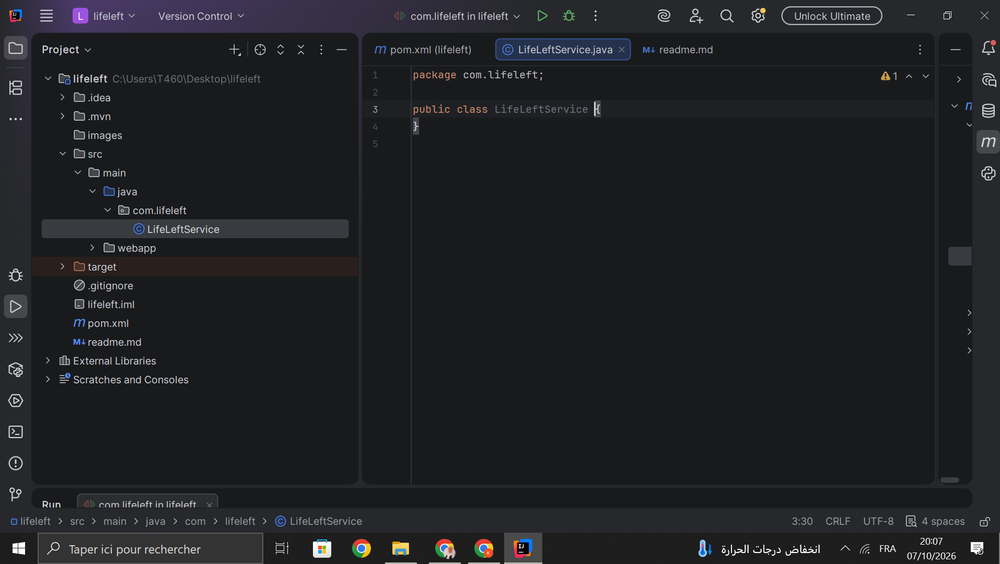

La classe `LifeLeftService` est créée dans le package `com.lifeleft` .

### 2. Code du service
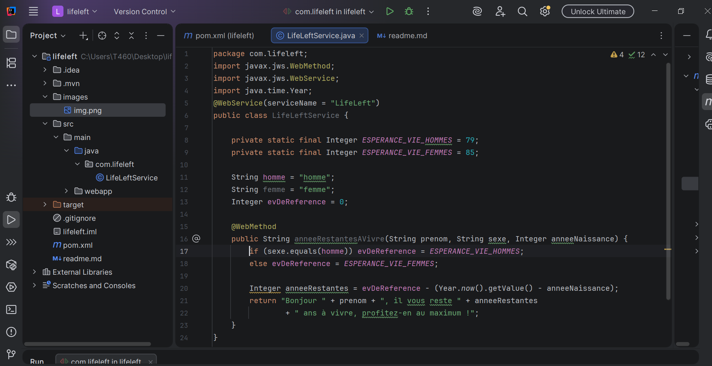

La classe contient le calcul, avec l'annotation `@WebService` sur la classe et `@WebMethod` sur la méthode `anneeRestantesAVivre`.

### 3. Configuration du pom.xml
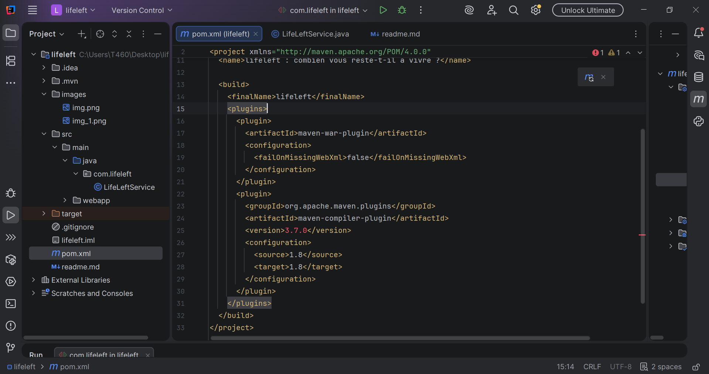

Le `pom.xml` déclare les deux plugins nécessaires  `maven-war-plugin` pour créer le `.war` et `maven-compiler-plugin` pour compiler en Java 1.8.

### 4. Fenêtre Maven
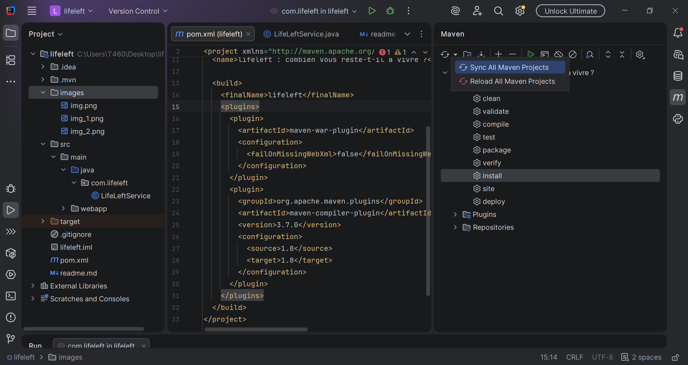

Dans l'onglet Maven, on recharge le projet puis on repère la phase `install` du cycle de vie.

### 5. Packaging du projet
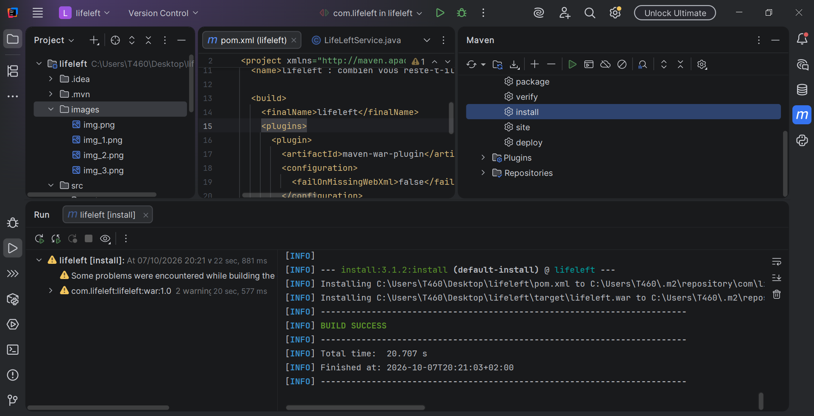

L'exécution de `install` se termine par `BUILD SUCCESS` : le fichier `lifeleft.war` est généré dans le dossier `target`.

### 6. Démarrage de GlassFish
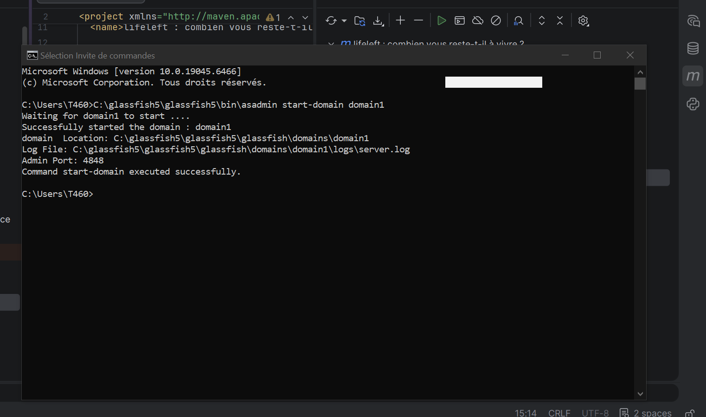

La commande `asadmin start-domain domain1` démarre le serveur et affiche `Command start-domain executed successfully`.

### 7. Console d'administration
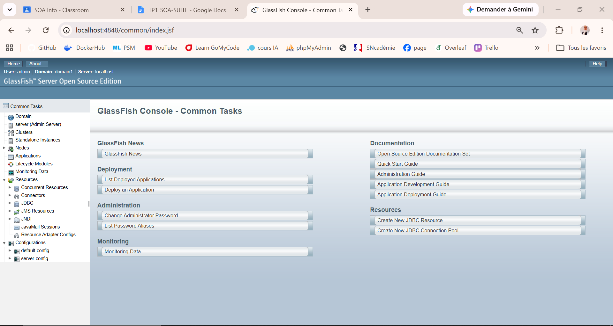

La console GlassFish est accessible sur `http://localhost:4848`.

### 8. Déploiement du `.war`
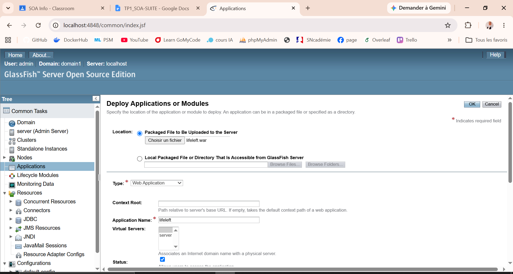

Dans le formulaire de déploiement on choisit `lifeleft.war` avec le type Web Application et le nom d'application `lifeleft`.

### 9. Liens de l'application
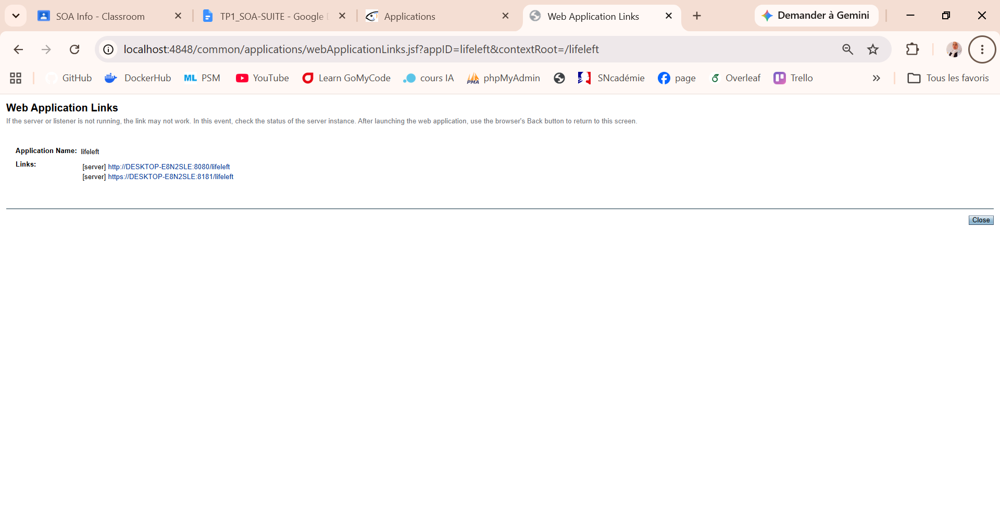

Après le clic sur Launch GlassFish propose deux liens vers l'application : un en http (port 8080) et un en https (port 8181).

### 10. Page d'accueil de l'application
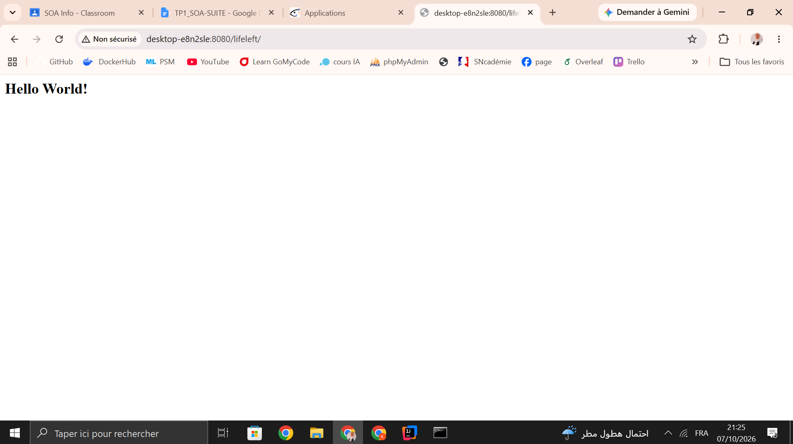

Le lien http affiche « Hello World! ».

### 11. Page du service web
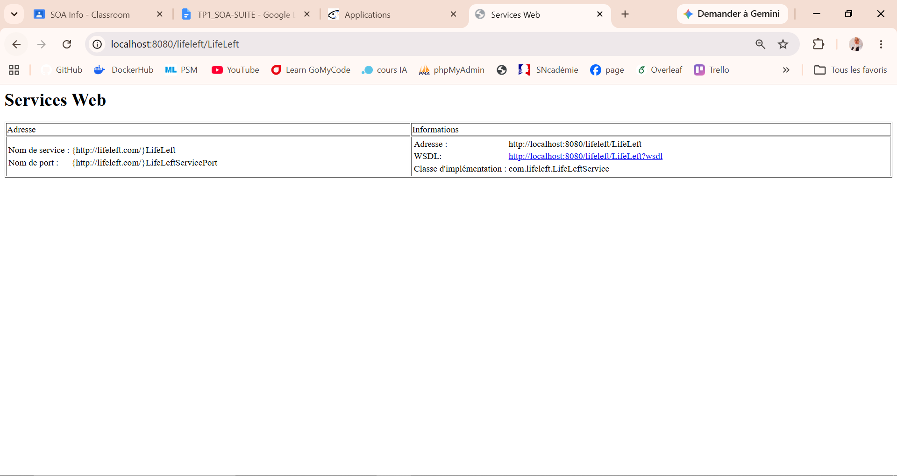

L'adresse `/lifeleft/LifeLeft` affiche le nom du service, le nom du port, l'adresse, le lien vers le WSDL et la classe d'implémentation.

### 12. Testeur du service
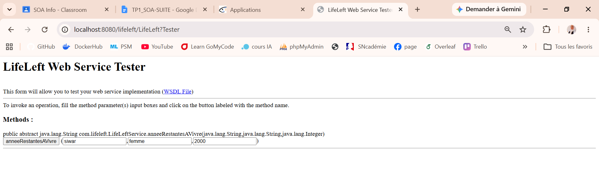

La page `?Tester` générée par GlassFish permet de saisir les trois paramètres (`siwar` `femme` `2000`) et d'appeler la méthode.

### 13. Résultat de l'appel
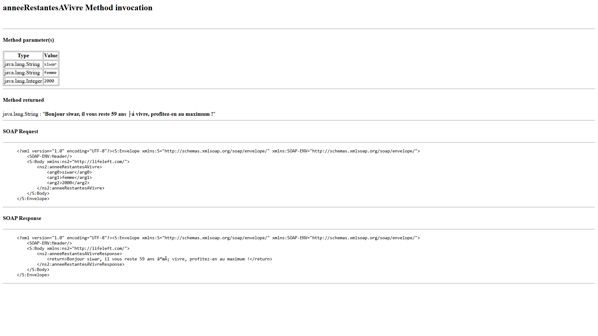

Le résultat affiche les paramètres la réponse « il vous reste 59 ans »  ainsi que la requête et la réponse SOAP échangées.